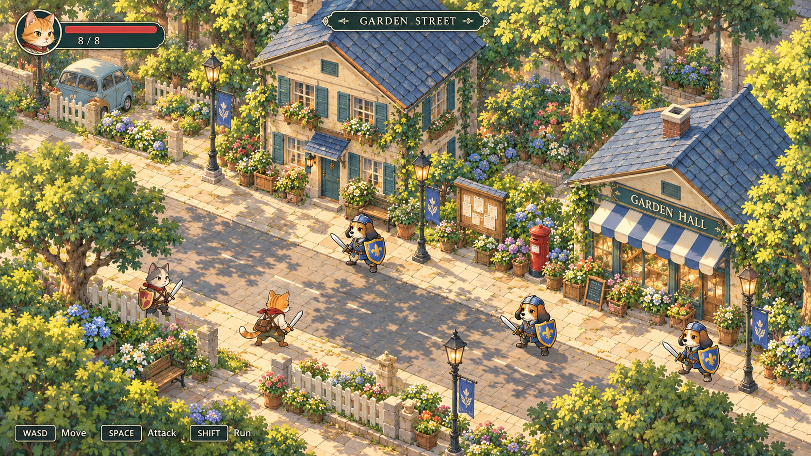
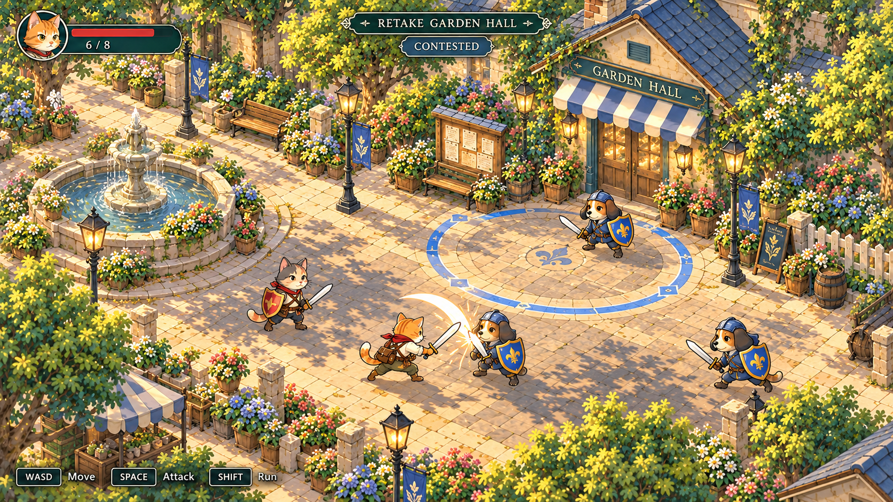
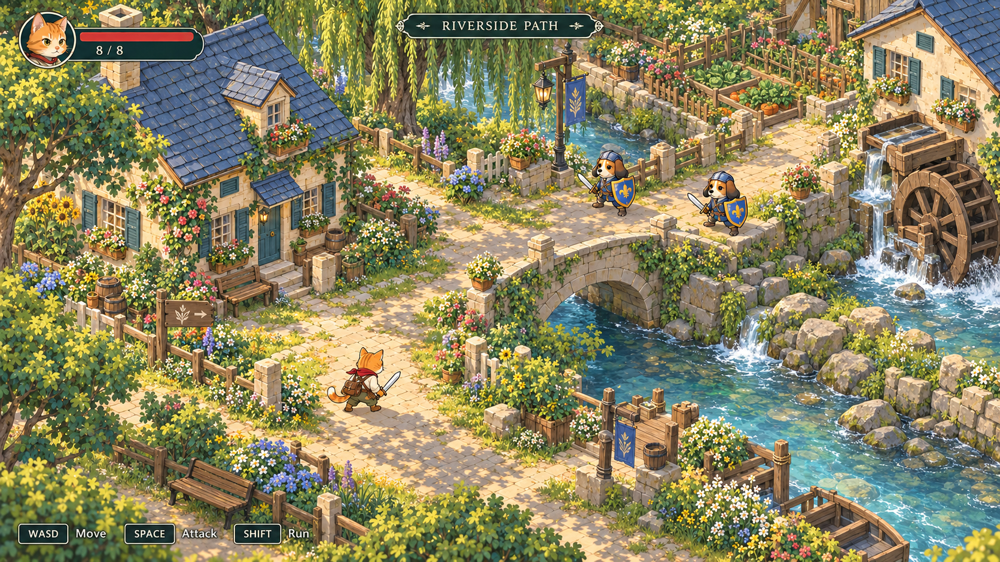

# Project Kingdom — isometric anime gameplay concepts

Three generated visual targets translate the painted anime town into the
current prototype's elevated isometric gameplay view. These are concept
mockups, not engine screenshots, modular assets, or performance measurements.
No gameplay code or existing demo assets were replaced.

1. **Garden Street** — the closest comparison with the current playable demo:
   a cat player, friendly cat guard and three dog opponents, readable street
   space, cream houses, blue slate roofs, gardens and a compact player HUD.
   
2. **Garden Hall Capture** — a small melee encounter in an open community-hall
   courtyard, with a blue ground boundary and contested objective feedback.
   
3. **Riverside Exploration** — the same camera and character language applied
   to a path, cottage, bridge, watermill and dog patrol beyond the town center.
   

## Shared direction

Use the current demo as a camera/layout reference and the previous anime town
painting as a palette/material reference. The intended camera looks down around
35 degrees with an orthographic three-quarter projection: roofs and two walls
remain visible, vertical structures stay upright, and there is no horizon.
Characters remain small enough to leave room for movement and combat.

Painted gouache/watercolor scenery, delicate architectural lines and softly
cel-shaded anime cats/dogs replace the pixel-art language. Cream plaster, teal
shutters, blue slate and warm stone connect the scenes. Cat red and dog blue
identify factions. Detail concentrates around borders and buildings while
central play surfaces stay open. A compact health plate, location/objective
caption and existing movement/attack/run prompts show the intended gameplay
presentation. HUD and combat effects here are illustrated design suggestions.

Ni no Kuni provides high-level atmosphere and town-exploration inspiration;
these are original locations and characters, not recreations of its maps or UI.
The first mockup is the visual anchor for the capture and riverside concepts.

## Sources

Generated using the built-in imagegen tool. Exact prompts and reference roles
are recorded in [generation_prompts.json](generation_prompts.json). Byte-for-byte
source copies, dimensions and hashes are recorded in
[asset_sources.json](asset_sources.json).

The first image references:
- `../town_skirmish_v03/previews/town_skirmish.png` for camera and layout only.
- `../anime_town_concepts_v04/01_garden_square.png` for painted anime art only.

The next two reference the first new gameplay concept for camera, art,
character scale and HUD consistency. A playable implementation would still
require separate scenery/model resources, animated characters, collision and
independent UI. Its 1080p60 performance would need to be measured in-engine.
