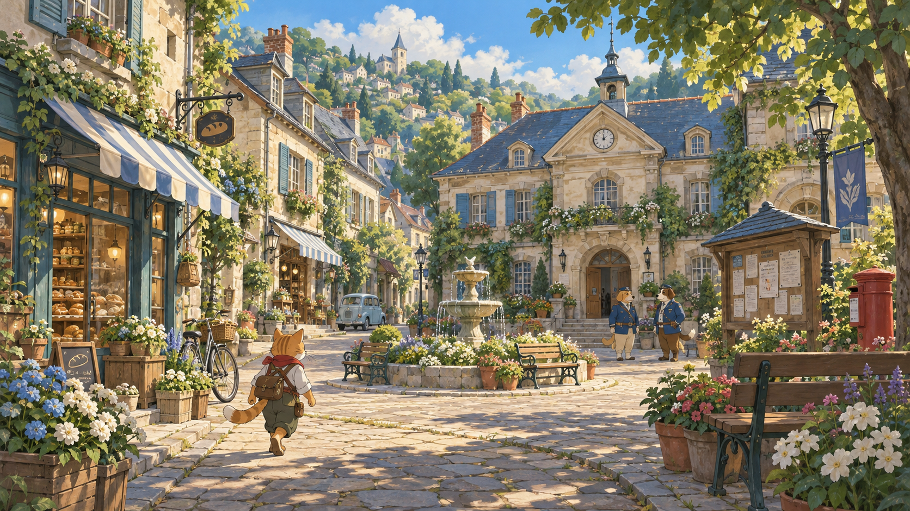
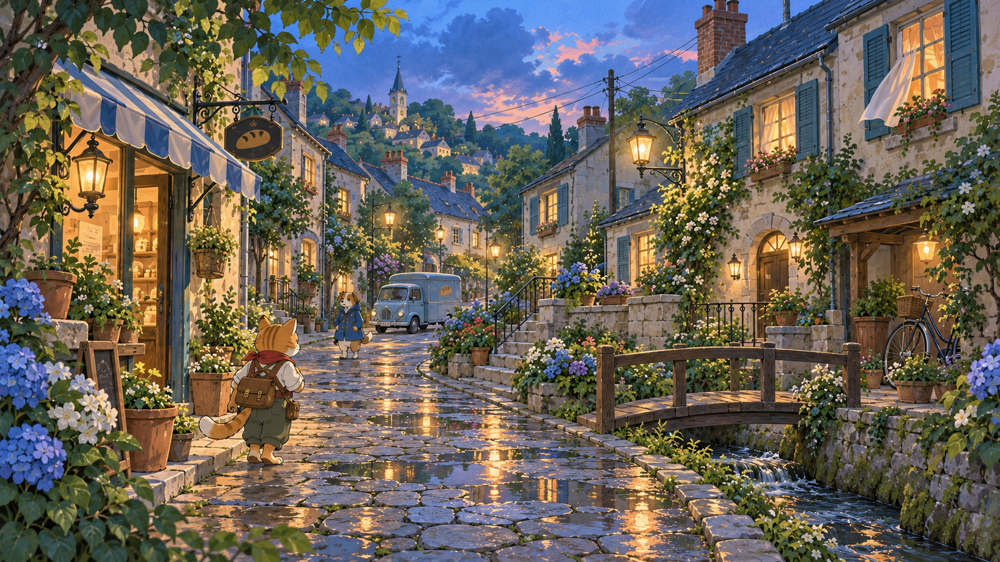
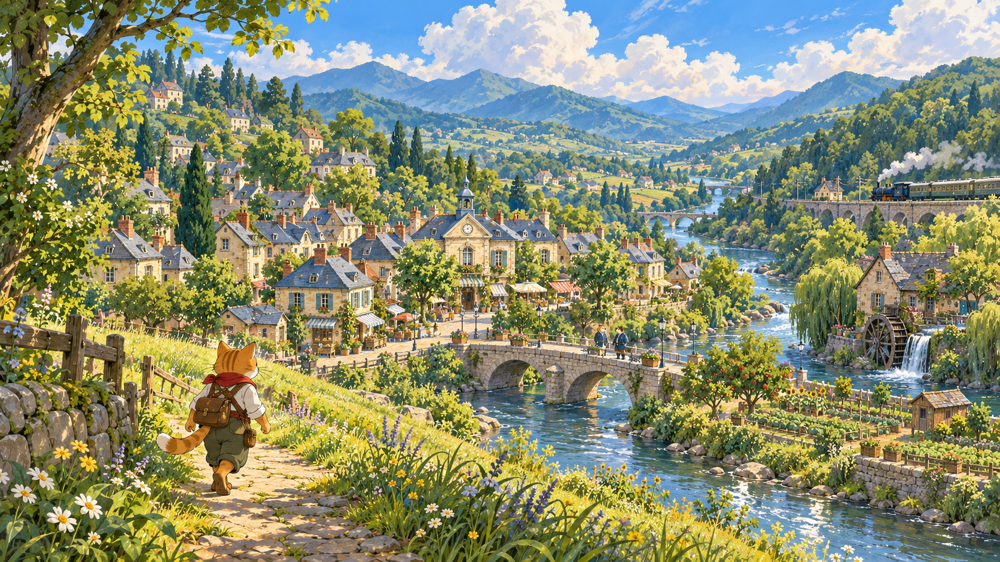

# Project Kingdom — painted anime world concepts

Three original concept paintings exploring a charming, nostalgic anime world.
Generated with the built-in imagegen tool. These are flattened concept paintings,
not modular environment assets, animation sheets, or in-engine screenshots.
The existing playable demo is unchanged.

1. **Garden Square:** warm afternoon light, a neighborhood hall, bakery, fountain,
   gardens, cat explorer and blue-clad dog wardens.
   
2. **Lane After Rain:** cool blue-hour atmosphere, warm windows, reflected lamps,
   hydrangeas, a stream and residential streets.
   
3. **Valley World:** the town extends into a river valley with gardens, an orchard,
   a mill, railway, footbridge and hillside exploration paths.
   

## Shared visual direction

Use softly painted watercolor/gouache backgrounds, delicate architectural lines,
expressive anime characters with clean silhouettes, and coherent perspective.
Cream plaster, teal shutters and weathered blue roofs connect all three scenes.
Greens, sky blues and warm ochres support restrained red cat / blue dog accents.
Vegetation and everyday objects make the world feel inhabited. Structures keep
straight verticals; charm comes from proportions and details rather than warped
houses. No pixel grid or existing franchise characters are used.

The square established the reference. The other two paintings use it as a style
and world reference, with distinct locations, lighting and compositions. See
[generation_prompts.json](generation_prompts.json) for the exact prompt set and
[asset_sources.json](asset_sources.json) for source paths, dimensions and hashes.

A playable version would need separate scenery layers or modeled architecture,
collision, and independently animated anime characters. These illustrations
establish the intended appearance; they do not demonstrate a real-time frame rate.
